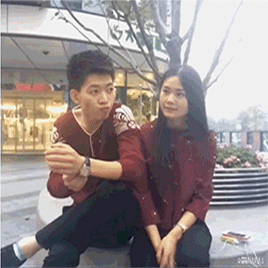

# 唯品会翻转展示 — JS定时器实现

> 使用JavaScript定时器 + CSS过渡动画实现两张图片的来回翻转切换效果

## 一、实现思路

```
不用@keyframes关键帧动画，而是:
  1. CSS中给div设置 transition: all 0.5s （样式变化时自动产生过渡动画）
  2. JS中用 setInterval 每0.5s改变一次div的样式
  3. 样式改变 → transition自动补间 → 产生旋转动画
```

## 二、动画流程拆解

一次完整循环共 **6秒**，状态改变的最小间隔是 **0.5s**，所以：

```
6s ÷ 0.5s = 12次计时 = 一个循环

计时次数:  1  2  3  4  5  6  7  8  9  10  11  12
图A状态:   显示 → → → 隐藏 隐藏 → → → → → 隐藏 显示
图B状态:   隐藏 → → → 隐藏 显示 → → → → → 隐藏 隐藏
           |--前4次--|第5次|第6次|--第7~10次--|第11次|第12次|
```

| 计时次序 | 图A（正面） | 图B（反面） | 对应步骤 |
|---------|------------|------------|---------|
| 第1~4次 | 显示状态 | 隐藏状态 | 步骤1（2s） |
| 第5次 | 旋转隐藏 | 隐藏状态 | 步骤2（0.5s） |
| 第6次 | 隐藏状态 | 旋转显示 | 步骤3（0.5s） |
| 第7~10次 | 隐藏状态 | 显示状态 | 步骤4（2s） |
| 第11次 | 隐藏状态 | 旋转隐藏 | 步骤5（0.5s） |
| 第12次 | 旋转显示 | 隐藏状态 | 步骤6（0.5s） |

## 三、完整代码

```html
<!DOCTYPE html>
<html lang="en">
<head>
    <meta charset="UTF-8">
    <title>唯品会翻转</title>
    <style>
        section {
            width: 300px;
            height: 300px;
            position: relative;
        }
        div {
            width: 100%;
            height: 100%;
            border: 1px solid;
            position: absolute;
            transition: all 0.5s;   /* 样式变化时自动产生0.5s过渡动画 */
        }
        #div2 {
            /* 默认反面是隐藏状态 */
            transform: rotateY(90deg);
            opacity: 0;
        }
        img {
            width: 300px;
            height: 260px;
        }
        p {
            text-align: center;
            margin: 0;
            line-height: 30px;
            background-color: white;
        }
    </style>
</head>
<body>
    <section>
        <div id="div1">
            
            <p>正面</p>
        </div>
        <div id="div2">
            
            <p>反面</p>
        </div>
    </section>
</body>
<script>
    var div1 = document.getElementById("div1");
    var div2 = document.getElementById("div2");

    // 状态改变的最小时间间隔是0.5s，所以计时器延时时间0.5s
    // 因为一次循环需要6秒，所以计时12次是一个循环
    var index = 0;  // 总计时次数
    setInterval(function () {
        index++;
        // 计时12次是一个循环，所以对12取余得到这次循环中的第几次计时
        if (index % 12 == 5) {   // 第5次：图A隐藏
            div1.style.transform = "rotateY(90deg)";
            div1.style.opacity = "0";
        }
        if (index % 12 == 6) {   // 第6次：图B显示
            div2.style.transform = "rotateY(0deg)";
            div2.style.opacity = "1";
        }
        if (index % 12 == 11) {  // 第11次：图B隐藏
            div2.style.transform = "rotateY(90deg)";
            div2.style.opacity = "0";
        }
        if (index % 12 == 0) {   // 第12次：图A显示
            div1.style.transform = "rotateY(0deg)";
            div1.style.opacity = "1";
        }
    }, 500);
</script>
</html>
```

## 四、关键点解析

### 1. transition 的作用

```
div {
    transition: all 0.5s;
}

当JS修改 div 的 transform 和 opacity 时:
  没有transition: 样式瞬间变化（生硬跳变）
  有transition:   样式在0.5s内平滑过渡（产生旋转动画）
```

### 2. 为什么用 index % 12？

```
一次循环 = 12次计时
index不断累加: 1, 2, 3, ... 12, 13, 14, ...

index % 12 的结果:
  index=12 → 0    （第12次，图A显示）
  index=13 → 1    （新循环的第1次）
  index=24 → 0    （又到第12次，图A显示）

→ 取余操作让计时在每次循环中重复相同的节奏
```

### 3. 为什么第12次是 index % 12 == 0？

```
12 % 12 = 0

所以判断第12次计时要用 index % 12 == 0
而不是 index % 12 == 12（永远不会成立）
```

### 4. 被注释掉的代码

```javascript
// if(index % 12 == 4){
//     div1.style.transform = "rotateY(0deg)"
//     div1.style.opacity = "1"
// }
// if(index % 12 == 10){
//     div1.style.transform = "rotateY(90deg)"
//     div1.style.opacity = "0"
// }

这两段被注释是因为:
  第4次时图A本来就是显示状态，无需重复设置
  第10次时图A本来就是隐藏状态，无需重复设置
  → 只在状态真正需要改变的时刻才修改样式
```

## 五、两种实现方式对比

| 对比项 | 纯CSS关键帧动画 | JS定时器 + transition |
|--------|----------------|----------------------|
| 代码量 | 较少 | 较多 |
| 控制力 | 只能自动循环 | 可灵活控制（暂停、手动切换等） |
| 性能 | 更优（浏览器底层优化） | 一般 |
| 实现难度 | 需要设计关键帧百分比 | 需要计算计时次数和取余 |
| 适用场景 | 简单的自动轮播展示 | 需要交互控制的场景 |

## 六、总结

| 要点 | 说明 |
|------|------|
| 过渡动画 | `transition: all 0.5s` 让样式变化平滑 |
| 定时器 | `setInterval(fn, 500)` 每0.5s改变一次状态 |
| 循环计算 | 6s循环 = 12次计时，用 `index % 12` 判断当前节拍 |
| 初始状态 | div2默认 `rotateY(90deg)` + `opacity: 0` 隐藏 |
| 状态切换 | 只在状态需要改变的时刻修改 transform 和 opacity |