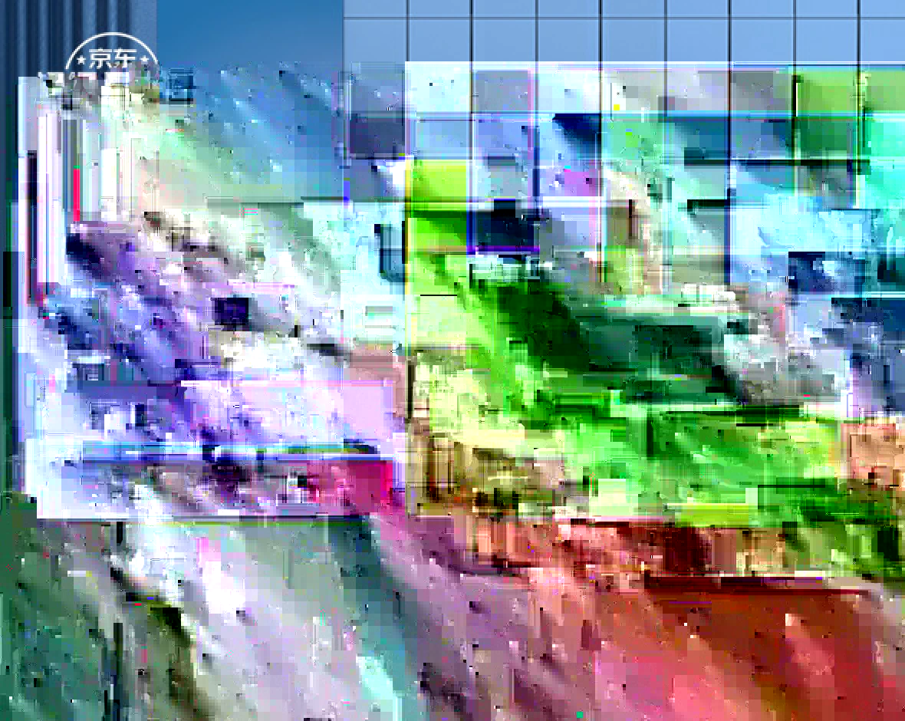

# jQuery 无缝轮播

> 使用 jQuery 实现图片无缝轮播，综合运用尺寸获取、样式操作、事件绑定与过渡动画

## 一、功能分析

```
无缝轮播 = 图片排列 + 坐标移动 + 边界穿越 + 指示器同步 + 自动播放 + 手动控制

核心问题:
  1. 图片如何无缝循环?    → 超出边界的图片瞬移到另一端
  2. 如何同步指示器?      → 索引更新 + addClass/removeClass
  3. 如何防止快速点击冲突? → moving 变量节流
```

## 二、页面结构

```html
<main>
    <div>
        
        
        
        
    </div>
    <ul>
        <li></li>
        <li class="active"></li>
        <li></li>
        <li></li>
    </ul>
    <div id="nav">
        <span id="left"><</span>
        <span id="right">></span>
    </div>
</main>
```

```
┌──────────────────────────┐
│  <span>         <span>   │  ← 左右箭头，hover 时显示
│     ┌──────────────┐     │
│     │   当前图片    │     │  ← 所有图片绝对定位，通过 left 排列
│     └──────────────┘     │
│        ● ○ ○ ○           │  ← 指示器 ul > li
└──────────────────────────┘
```

## 三、初始化图片排列

```javascript
// 获取 main 宽度（jQuery 方式）
var width = $("main").width();
var index = 0;       // 默认展示第1页，索引为0
var timer;
var moving = false;  // 记录是否正在过渡，用于节流

// 设置四张图片的 left 坐标，使其左右排列
$("main img").each(function(index, item){
    $(item).css("left", index * width + 'px')
})

// 最后一张图放到第一张图左侧（无缝关键）
$("main img").last().css("left", -width + 'px')
```

```
初始排列:
  img4(-400)  img1(0)  img2(400)  img3(800)
      ←          可视区        →
```

> **为什么最后一张要放在左侧？** 这样向左切换到第1张之前，还能看到第4张，实现"无缝"效果。

## 四、轮播核心函数

```javascript
function move(offset){
    // (一) 所有图片坐标减/加一个 width，实现左滑或右滑
    $("main img").each(function(i, item){
        // position() 获取相对于父标签的坐标，返回对象含 left 和 top
        var left = $(item).position().left;
        left -= width * offset;

        // 判断边界：超出可视范围则瞬移到另一端
        if(left < -width || left > width*2){
            // 从下层穿过，避免看到瞬移过程
            $(item).css("z-index", 0)
            // 监听过渡结束事件，还原层级
            $(item).on("transitionend", function(){
                $(this).css("z-index", 10)
                moving = false;  // 过渡结束，更新状态
            })

            // 判断是左边界还是右边界
            if(left < -width){
                left = width * 2
            } else {
                left = -width
            }
        }

        // 更新图片位置
        $(item).css("left", left + 'px')
        moving = true;  // 过渡开始，记录状态
    })

    // (二) 更新指示器
    $("li").eq(index).removeClass("active")
    index += offset
    if(index > 3) index = 0
    if(index < 0) index = 3
    $("li").eq(index).addClass("active")
}
```

### 边界穿越图解

```
向右切换 (offset=1):

  移动前:  img4(-400)  img1(0)✓  img2(400)  img3(800)
  移动后:  img3(-400)  img4(0)   img1(400)✓ img2(800→瞬移-400)
                                              ↑ 超出右边界，瞬移到左侧
```

## 五、自动播放与手动控制

```javascript
// 定时器自动轮播
timer = setInterval("move(1)", 2000)

// 鼠标移入暂停，移出继续
$("main").mouseenter(function(){
    clearInterval(timer)
})
$("main").mouseleave(function(){
    timer = setInterval("move(1)", 2000)
})

// 手动轮播（带节流判断）
$("#left").click(function(){
    if(moving) return;  // 正在过渡中，不响应
    move(-1)
})
$("#right").click(function(){
    if(moving) return;
    move(1)
})
```

## 六、节流四步法（限制快速连续点击）

| 步骤 | 代码 | 说明 |
|------|------|------|
| 1. 定义变量 | `var moving = false;` | 全局定义 |
| 2. 过渡开始置 true | `moving = true;` | 更新坐标后 |
| 3. 过渡结束置 false | `moving = false;` | transitionend 回调中 |
| 4. 点击时判断 | `if(moving) return;` | 手动轮播函数开头 |

## 七、涉及的 jQuery API

| API | 说明 |
|-----|------|
| `$("main").width()` | 获取元素宽度 |
| `$(item).css("left", val)` | 设置/获取样式 |
| `$("img").each(fn)` | 遍历 jQuery 对象 |
| `$("img").last()` | 获取最后一个元素 |
| `$(item).position().left` | 获取相对于定位父元素的坐标 |
| `$("li").eq(i)` | 按索引获取元素 |
| `addClass()` / `removeClass()` | 添加/移除类名 |
| `$(item).on("transitionend", fn)` | 绑定过渡结束事件 |
| `mouseenter()` / `mouseleave()` | 鼠标移入/移出事件 |

## 八、总结

| 要点 | 说明 |
|------|------|
| 无缝原理 | 超出边界的图片降低层级后瞬移到另一端 |
| 坐标获取 | `position()` 获取相对定位父元素的坐标 |
| 层级控制 | 瞬移时 `z-index` 置 0，过渡结束后还原 |
| 过渡监听 | `transitionend` 事件在 CSS 过渡结束后触发 |
| 节流控制 | `moving` 变量防止快速点击造成过渡冲突 |